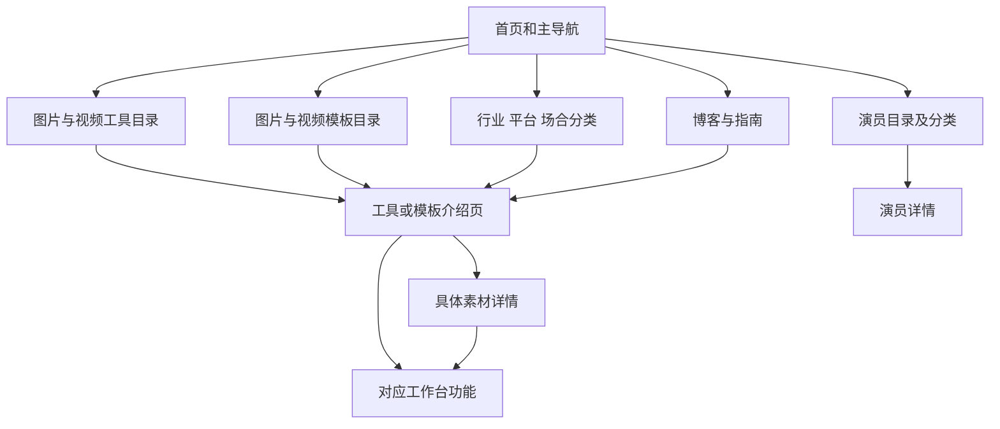

# AIVideosUGC 全站链路与 SEO 结构复评

## 结论

主链路已能正常完成浏览、选择模板与进入工作台，当前可索引页面的技术 SEO 基础较完整。下一阶段优先处理本地整改的安全发布、素材身份统一、分类覆盖和文章入口清理。

本轮仅评估。未修改业务代码、站点关系数据或线上部署版本，未运行内容生成或恢复历史数据。

## 评估范围

| 环境 | 覆盖 | 版本 |
|---|---|---|
| 生产 | 348 个请求地址，包含全部 177 个 sitemap 地址、当前公开页面记录、旧映射入口及部分私有入口和参数地址 | `4fb509bfb5ee7cc3512065901abc70e63291fa57` |
| 本地 | 350 个请求地址，包含全部 178 个 sitemap 地址与相同类型的旧入口检查 | `3113` 上运行的 `.next-seo-path-release` 构建 |
| 生产浏览器 | 图片模板、视频模板到指定工作台；演员详情 | 新建匿名会话，未提交生成或支付 |
| 本地浏览器 | 平台目录、筛选、后退、素材归属、详情到工作台、移动端、禁用 JavaScript | 与当前本地关系数据读回配合检查 |

生产请求清单已与当前页面与重定向清单逐条核对，缺失请求为 0。数据从 2026-10-21 18:45（北京时间）起采集；生产代码版本在补充读回时保持一致。

“未发现死链”限定于已请求并解析的目标。图中另有生产 223 个、本地 225 个未在本轮逐一请求的目标，多为派生素材与交互地址；未逐一打开全部 987 个素材地址。图片和视频文件没有全量逐文件下载，JSON-LD 检查不等同于 Google 富媒体结果资格验证。未接入 Search Console，因此不判断实际收录量与排名。

## 一 主要浏览与转化链路



### 已确认正常的链路

- 图片和视频模板目录有对应模板入口，点击后进入相应介绍页，选择模板后进入固定的图片或视频工作台。
- 工作台保留所选模板；本地素材案例也能带入提示内容，没有回到通用首页后丢失选择。
- 演员详情采用扁平地址，旧性别层级地址通过永久重定向兼容。
- 本地平台总目录为独立页面，有六个有效的平台入口；鞋类目录具备实际鞋履示例与返回分类的链接。
- 生产浏览器三组检查通过，pageerror 为 0，未发现同域公开数据 fetch/XHR/EventSource 请求。为降低生产负载，本次生产浏览器拦截图片、视频与字体请求，因此不将其算作生产媒体加载验收。
- 本地六组浏览器检查通过；六个平台图片加载成功，移动端无横向溢出，关闭 JavaScript 后目录和筛选结果仍完整。

### 线上与本地的差异

| 项目 | 当前生产 | 当前本地 |
|---|---|---|
| `/platforms` | 301 到视频总页；有 22 个已抓取页面引用该入口 | 独立目录返回 200，展示六个平台 |
| 单一类型筛选 | `kind=photo` 返回参数页面 | 308 到 `/templates/photo` |
| 组合筛选 | 有筛选结果，canonical 仍指总目录 | 保留全部有效条件，使用规范参数身份 |
| 参数页索引输出 | 响应头 noindex，但 meta robots 仍为 index | 按参数页策略输出 noindex |
| 鞋类素材与分类投放 | 上一轮鞋类试点尚未发布 | 已有真实素材投放；本轮关系数据已有更多经其他任务补充的分类 |
| 五条短地址试点 | 仍使用线上原地址 | 短地址有效，旧地址永久跳转 |

这些差异属于尚未发布的整改，不能据此判断线上数据发生回退。

## 二 可索引页面结构

| 检查项 | 生产结果 | 本地结果 |
|---|---:|---:|
| sitemap 唯一地址 | 177 | 178 |
| sitemap 非 200 地址 | 0 | 0 |
| sitemap noindex 页面 | 0 | 0 个页面级 noindex |
| sitemap canonical 不一致 | 0 | 0 |
| sitemap 单一 H1 不满足 | 0 | 0 |
| sitemap 中未能从首页链接图到达的地址 | 0 | 0 |
| 首页到 sitemap 页的最大观测链接深度 | 2 | 2 |
| 已检查可索引页面的完全重复 title | 0 | 0 |
| 已检查可索引页面的完全重复 description | 0 | 0 |
| 已检查可索引页面的完全重复主体文本 | 0 | 0 |
| JSON-LD 解析错误 | 0 | 0 |

本地预览环境通过 robots.txt 与响应头统一限制索引，这是环境隔离。表中本地索引判断使用页面自身的 meta 规则，没有把 localhost 的统一 noindex 当成全站缺陷。

目录、页面正文、canonical、OG 与结构化身份的抽取结果相符。没有发现 sitemap 中混入工作台或重定向源地址。首页可经普通 HTML 链接到达全部已列出的索引页，导航可发现性较好。

标题或主体没有完全重复，不等于不存在主题重叠、相似 FAQ 或内容质量差异。行业页的实际素材相关性、可索引案例的独立价值仍需要内容审核。

## 三 剩余问题与优先级

### P1 发布本地已通过的整改

生产仍缺平台总目录，参数页的 meta robots、响应头与 canonical 策略尚未统一。优先按精确代码版本与生产当前字段清单发布本地已验收的改动，发布后重新检查源站、公网与工作台链路。

生产参数页已有响应头 noindex，本轮没有把它们计为可索引的重复页面。统一输出有利于后续维护，但不能据此宣称已经造成排名损失。

### P1 统一素材身份与规范详情

本地当前数据包含 1005 处卡片引用、987 个不同 publicSlug。按 `kind + video.src`、无视频时按 `image.src/poster` 分组，得到 285 个候选资源组。

| 分组现象 | 数量 |
|---|---:|
| 同一媒体来源有多个 publicSlug 的组 | 37 |
| 涉及卡片引用 | 739 |
| 单组最多卡片引用 | 21 |
| 同组存在不同展示名称 | 18 组 |

已实际核验两个详情：

```text
/ai-video-generation/streamer-reaction-app
/ai-video-generation/app-reaction-clip
```

两者都返回 200，使用同一张媒体图，但各有自己的名称和自引用 canonical，均为 `noindex, follow`。这说明目录去重与产品身份聚合已有进展，详情地址仍未完全合并。

建议为每组确认一个稳定资源身份、规范名称和首选详情地址，其余页面卡引用该资源。只有确认媒体及生成语义可以共用时才合并地址；不同上下文的生成预设应保留，不能仅凭相同主图覆盖它们。

当前详情 noindex 限制了直接索引重复的风险。开放案例索引前，应先完成身份确认和逐页内容审核。

### P2 扩大真实分类覆盖

本地 285 个候选资源组中，25 组已有显式 placement，18 组为可通过模板目录推导归属的模板资源；合计 43 组约占 15%。其余 242 组尚未通过这两类规则建立归属。

这不等于 242 组全部不可访问，也不等于应一次性打标。建议优先整理常用且已公开展示的素材，逐批核验行业、平台、场合的适用性。目录列出素材后，详情分类链接与目录实际展示必须一致。

同一个素材进入多个目录时，共用资源身份和规范详情地址；不按目录复制产品，也不自动继承 owner 页或旧 chips 的所有标签。

### P2 清理旧内链与文章落点

生产有 14 类、其中本地仍有 13 类站内链接需要经过重定向。大部分目标可达，属于维护与体验问题。

四个页脚“最新文章”的旧地址分别出现在 180 个已抓取的有效页面中。尤其：

```text
/blog/motion-generator-video-guide
  → /ai-video-generation/image-to-video
```

用户从文章入口进入工具页，名称与落点不一致。建议最新文章列表只选择当前有效的文章实体，并直接链接其最终规范地址；最终目标属于工具的退役文章不再作为“最新文章”展示。正文中的旧工具别名也应逐字段更新到最终地址，历史重定向继续兼容外部旧链接。

### P2 保持清晰的案例索引策略

素材详情当前主要承担浏览与工作台选择职责，统一 noindex 可以继续保留。希望获取案例搜索流量时，先挑少量资源补齐真实用途、操作说明、输入与输出示例、适用限制和独立 SEO 内容，再按单一资源身份开放索引。

不建议把 987 个地址一次性设为 index，也不建议为了形成目录层级自动生成大量相似页面。

## 四 需要纠正的旧审计结论

以下只描述本轮实际返回结果，旧文档的数据库推断不能直接作为删除或覆盖数据的依据。

| 旧判断 | 本轮实际结果 |
|---|---|
| 41 个旧重定向未生效 | 生产 66 条、本地 65 条配置映射均返回永久重定向，目标可达；本地少一条是 `/platforms` 已成为独立页面 |
| 搜索页可索引 | `/search` 301 到模板目录，并带 noindex 响应头 |
| Help 与 FAQ 重复在线 | `/help` 308 到 `/faq` |
| 隐私及条款别名重复返回 200 | 已检查别名通过永久重定向归到规范页面 |
| 库内存在退役页面就需要恢复或补页面 | 退役路径不在 sitemap，已抓取活页面没有指向它们的已验证死链；404/410 本身不是恢复旧数据的理由 |

因此，本轮没有确认需要立即修复的全站抓取阻断。应保持现有重定向和退役规则，避免根据旧列表批量删除、恢复页面或重写 SEO。

## 五 后续顺序

1. 安全发布已验收的平台目录、筛选规则与试点字段。
2. 清理最新文章入口和正文中的旧内链，改善用户点击后的内容一致性。
3. 确认资源身份与重复详情的处理清单，再分批补齐分类归属。
4. 审核少量真正具备独立内容的案例页，试点开放索引。
5. 发布后通过 Search Console 观察 canonical 选择、抓取、索引和流量；不能用本轮技术检查替代搜索表现数据。

## 证据与依据

- [生产汇总](../../releases/aidreamcapes/overall-chain-seo-20261021/production-summary.json)
- [本地汇总](../../releases/aidreamcapes/overall-chain-seo-20261021/local-summary.json)
- [生产完整 HTTP 记录与覆盖核对](../../releases/aidreamcapes/overall-chain-seo-20261021/production-crawl.json)
- [生产浏览器链路结果](../../releases/aidreamcapes/overall-chain-seo-20261021/production-browser.json)
- [本地浏览器链路结果](../../releases/aidreamcapes/overall-chain-seo-20261021/browser-checks.json)
- [当前资源分组](../../releases/aidreamcapes/overall-chain-seo-20261021/local-products.json)
- [重复媒体详情读回](../../releases/aidreamcapes/overall-chain-seo-20261021/local-duplicate-media-readback.json)
- [Google canonical 指南](https://developers.google.com/search/docs/crawling-indexing/consolidate-duplicate-urls)：重定向、canonical 和 sitemap 应指向一致的首选地址。
- [Google 链接指南](https://developers.google.com/search/docs/crawling-indexing/links-crawlable)：可抓取链接和相关锚文本帮助发现与理解页面。
