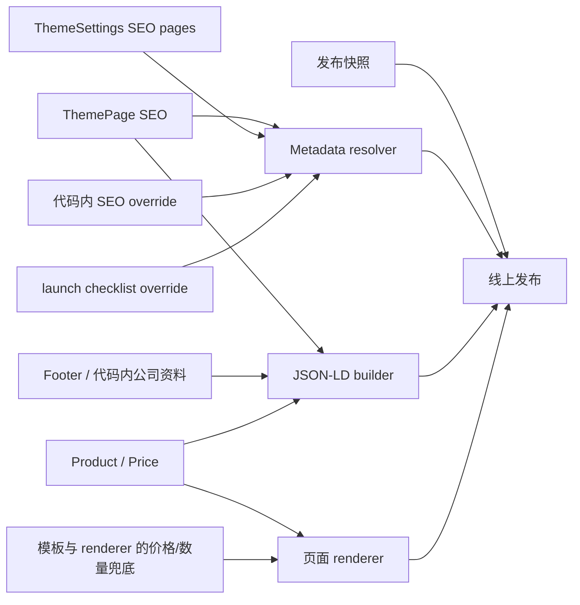
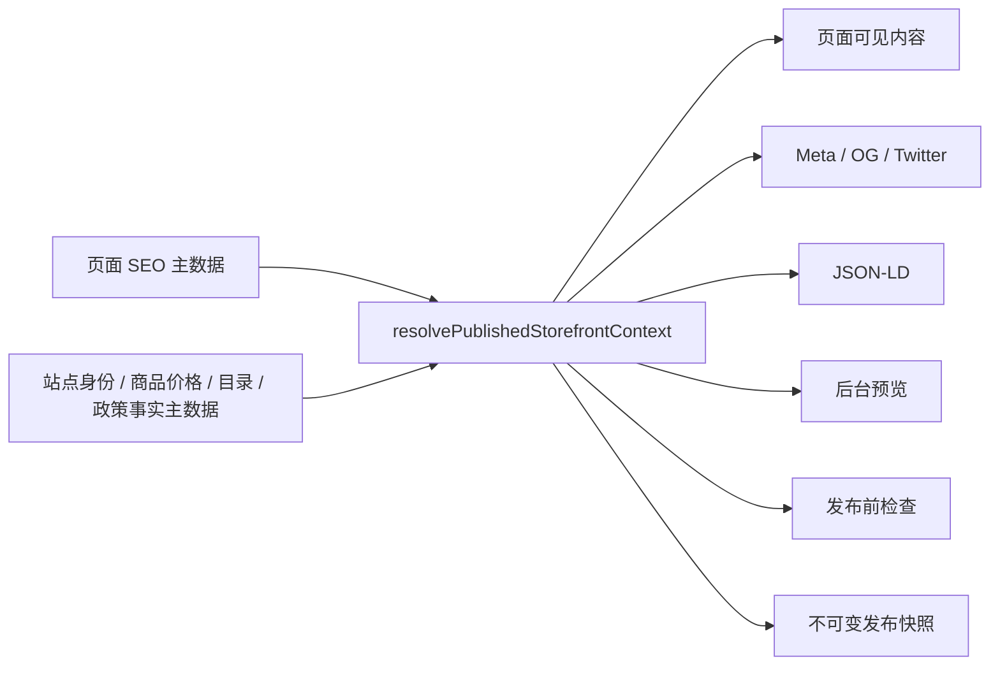

# myDreamshoots 单一事实源深度审计与程序整改计划

审计日期：2026-08-18（Asia/Shanghai）
审计对象：myDreamshoots 首页、SEO/JSON-LD、价格与商品、品牌/法人、工作流数量、政策承诺、主题发布链路及线上部署结果
审计性质：只读代码、数据库和线上输出核验；本文不修改业务代码、数据库或线上配置
关联材料：`myDreamshoots_001首页最终整改方案_20260817.md` 及用户提供的 4 张截图

## 1. 结论

用户指出的两点都成立，而且不是两处孤立的文案错误：

1. **页面 SEO 与 JSON-LD 应当使用同一份“已发布页面语义”，当前没有完全做到。** 两者虽然会调用部分相同函数，但页面 SEO 同时存在于 `ThemePage.publishedJson.seo`、`ThemeSettings.publishedJson.seo.pages`、代码内站点覆盖和 launch-checklist 覆盖中；JSON-LD 又单独组装 Organization、SoftwareApplication、Product、FAQ 等对象。结果是“保存位置、预览值、Meta 实际值、JSON-LD 实际值”可能不同。
2. **价格必须来自一套正式的商品/价格数据，当前只是局部动态化。** 首页最低订阅价格已有动态 token，但模板、渲染兜底、测试和其他页面仍保留 `$24.50`；同时当前 `Price` 缺少公开状态和生效时间，渲染器还会在找不到 active 商品或指定账期价格时退回其他数据。这会让页面看似可配置，实际仍可能显示旧价或错误价。
3. **根因是缺少“事实所有权”和统一发布上下文。** 现有系统把同一事实分散在数据库记录、主题 JSON、模板、渲染器、脚本和发布快照中，没有明确哪些是唯一可编辑主数据、哪些只是只读派生结果。
4. **问题范围大于 SEO 和价格。** 本次还确认了品牌/法人主体、社交账号、商品权益、每次生成 credits/结果数、主题数量、隐私/退款承诺、政策更新时间、版权年份、发布粒度和线上版本识别等同类问题。
5. **不能把“所有重复存储”一律删除。** `draft`、`published`、不可变发布快照和缓存可以保留，因为它们服务编辑、回滚和性能；但必须只有一个可编辑主源，所有副本都可追溯、不可独立编辑、可由主源重建。

当前风险级别：**P0，建议暂停继续向模板、renderer 或同步脚本添加任何价格、法人、计数、政策承诺等事实字面量，先完成事实源治理。**

## 2. 审计方式与边界

本次交叉核验了四类证据：

- 用户文档和截图中的首页整改项；
- 本地源码、Prisma 数据模型、后台 SEO 编辑器、发布流程、模板和 smoke scripts；
- 当前 PostgreSQL 中 ThemePage、ThemeSettings、ThemePublication、Product、Price、CreativePack 等数据；
- `https://www.mydreamshoots.com/`、`/pricing`、`/about-us` 的公开 HTML、Meta 和 JSON-LD。

本报告确认程序是否存在多源、覆盖、兜底和发布风险，但不替业务或法务决定真实法人、社交账号归属、退款条件、照片删除周期等事实。存在冲突的法律/业务字段必须由负责人确认，程序不能猜一个值自动覆盖。

## 3. 当前数据流为什么会失真



当前不是“一份数据，多种输出”，而是“多个数据源，各自按优先级覆盖后输出”。只要后台改的是低优先级数据、线上仍运行旧版本、缓存未失效，页面就会继续显示旧值。

目标必须收敛为：



## 4. 已确认问题清单

### P0-1：页面 SEO 存在多套可编辑数据和代码覆盖

**证据**

- `src/lib/theme/seo.ts:455` 附近同时读取页面 SEO、ThemeSettings 页面映射、policy SEO 和站点级默认值。
- `src/lib/theme/seo.ts:263`、`:305` 还有 myDreamshoots 专用 launch-checklist 和 route override，可以在运行时再次覆盖数据库值。
- `src/components/admin/seo-settings-editor.tsx:106` 从 `seo.pages[page.id]` 编辑所谓的页面 SEO，并在 `:175` 保存到 ThemeSettings draft，而不是实际的 `ThemePage.draftJson.seo`。
- 当前数据库中首页 `ThemePage.publishedJson.seo.description` 与 `ThemeSettings.publishedJson.seo.pages[home].description` 同时存在且内容不同。
- 本地当前代码读取同一数据库能算出新 description，线上 HTML 仍输出旧 description，说明还叠加了部署版本或缓存差异。

**风险**

- 后台显示“已保存”并不代表线上 Metadata 使用了这个值；
- Meta 与 JSON-LD 可能因各自重建字段而漂移；
- publish preflight 只检查“是否能算出 SEO”，不会阻止多个源互相冲突。

**整改决定**

- 页面 SEO 的唯一可编辑主源定为 `ThemePage.draftJson.seo` / `ThemePage.publishedJson.seo`；
- `ThemeSettings.seo` 只保留站点级默认项，例如 title template、默认 OG 图、默认 robots，不再保存 `pages` 映射；
- 删除 mydreamshoots route-specific 文案覆盖；需要默认值时只在创建页面时写入 draft，不在读取时偷偷覆盖；
- Metadata 和 JSON-LD 必须从同一个 `ResolvedPageSeo` 对象读取 title、description、canonical、image、robots 和语言。

### P0-2：品牌、法人、地址和社交账号不是一套数据

**证据**

- `src/lib/theme/json-ld.ts:284-312` 为 myDreamshoots / Aidreamcapes 硬编码 company profile；myDreamshoots 的 `legalName` 当前是 `myDreamshoots.com`。
- `src/components/theme-renderer.tsx:1741-1751` 对两个站点的页脚公司名使用代码 fallback，并有意绕过部分已配置值。
- `src/lib/theme/packages/dreamshoot-ai-studio/templates.ts:178` 与 `src/components/theme-renderer.tsx:12603` 的 About 文案写的是 `MRNARUEBET LLC`。
- 当前 JSON-LD 的 Organization 使用 `myDreamshoots.com`，可见 About 内容使用 `MRNARUEBET LLC`，`sameAs` 又指向 Blydey 社交账号。
- 同一组 Blydey 社交 URL 在当前站点相关 JSON、主题副本和发布快照中大量重复；其中一部分是合法快照，另一部分仍是可编辑副本或脚本字面量。

**风险**

- Organization Schema、About、Footer、Contact、政策页和社交身份互相矛盾；
- `legalName` 如果填域名/品牌而非真实注册主体，会形成法律和搜索实体识别风险；
- Blydey 与 myDreamshoots 的关系当前没有可靠、统一、可见的说明。

**整改决定**

- 新增一对一 `StorefrontProfile`（或等价显式模型），归 `Site` 所有，保存 brandName、legalName、entityType、结构化地址、supportEmail、phone、brand-owned socialLinks、默认 logo 等；
- 法人、地址、联系方式、social `sameAs` 只允许从该模型编辑；Footer、Contact、About 和 JSON-LD 只引用 profile；
- 发布快照可保存 profile 的 resolved copy 供回滚，但不得成为另一个编辑入口；
- **上线前业务/法务必须确认：真实法人到底是 `MRNARUEBET LLC`、`myDreamshoots.com` 还是其他主体，以及 Blydey 社交账号是否确属本品牌。确认前不得自动选值。**

### P0-3：价格只完成了一半动态化，价格生命周期也不完整

**证据**

- `src/components/theme-renderer.tsx:6935-6978` 已有 `{LIVE_LOWEST_ACTIVE_PLAN_PRICE}` 解析，但只是 renderer 内部替换。
- `src/lib/theme/packages/dreamshoot-ai-studio/templates.ts:179`、`:1046` 及相关同步/测试脚本仍保留 `$24.50` 字面量。
- `prisma/schema.prisma:356` 的 `Price` 没有 `status`、`isPublic`、`effectiveFrom`、`effectiveTo`；active Product 下的所有价格都可能被视为有效报价。
- `src/components/theme-renderer.tsx:6925-6932` 在没有 active 商品时会退回全部商品；`:8269-8270` 还可能把其他 active 商品放入订阅价格表。
- `src/components/theme-renderer.tsx:6823` 在找不到用户所选 billing cycle 时会静默取另一账期价格。
- `src/lib/theme/json-ld.ts:567-615` 为 active 商品的所有价格生成 Offer；其最低价口径可以包含一次性 credit pack，而页面“Plans start at”表达的是订阅起价。

**风险**

- 管理员改一次价格后，首页、pricing、checkout 文案、JSON-LD Offer、旧模板和测试值不一定同步；
- “最低价格”可能把一次性充值包和月付订阅混为一谈；
- 下架商品、未公开价格或错误账期可能被 fallback 重新展示。

**整改决定**

- `Product` / `Price` 是唯一商业报价主源；给 `Price` 增加明确生命周期和公开属性；
- 定义三个不同指标，禁止继续使用含糊的 `lowest price`：`lowestPublicMonthlySubscriptionPrice`、`lowestPublicOneTimeCreditPrice`、`selectedOfferPrice`；
- 页面和 Schema 的同一报价从同一个 `ResolvedOffer` 读取；
- 找不到 active/public/当前生效价格时隐藏价格区或阻断发布，不得回退到 inactive 商品、其他账期或旧字面量；
- 删除模板、renderer、seed/sync script 和 smoke test 中的生产价格字面量。

### P0-4：发布 API 看似发布单页，实际会发布整站所有草稿

**证据**

- `src/lib/stores/theme-store.ts:1222-1227` 在一次 publish 中把 ThemeSettings draft 和 `site.pages` 的所有页面 draft 全部复制到 published。
- `src/lib/stores/theme-store.ts:133` 的 publication snapshot 随后保存整站结果。
- 当前 UI/调用参数带有 page 概念，但行为本质上是 site-wide publish。

**风险**

- 修改一个首页 SEO 并发布，可能连带发布其他尚未审核的页面、价格文案或全站设置；
- 操作者无法从按钮和预检结果准确知道本次影响范围。

**整改决定**

- 支持真正的 `publishPage(pageId, expectedDraftVersion)`；
- profile、全局设置或主题升级使用明确的 `publishSite(manifest)`，发布前展示所有变化对象；
- 所有 publish 都使用 optimistic concurrency，生成 publicationId、事实 revision 和变更清单；
- 整站不可变快照继续保留，作为回滚资产，不视为重复主数据。

### P0-5：线上内容无法确认对应哪个代码和发布版本

**证据**

- 审计时 `www` 和 apex 线上 HTML 仍含旧 description、`$24.50`、`MRNARUEBET LLC` 和 `Browse all 38`；
- 本地当前代码连接当前数据得到的新 description 与线上不同；
- 响应没有足够的 build SHA / publication version 标识来区分旧部署、旧快照或 CDN 缓存。

**风险**

- 数据改对后仍可能因部署或缓存显示旧值；
- 无法快速判断线上问题属于数据、代码、快照还是缓存。

**整改决定**

- 响应头增加不含敏感信息的 `x-storefront-build`、`x-storefront-publication`、`x-storefront-facts-revision`；
- 页面数据缓存 key 必须包含 publication 和 facts revision；发布/改价/改 profile 后执行定向失效；
- 发布流水线同时验证 origin、apex、www 的 HTML、Meta、JSON-LD 与版本头，不只验证后台保存成功。

### P0-6：政策、隐私和退款承诺属于事实，却分散为文案 fallback

**证据**

- `No AI training`、`30-day auto-delete`、退款保证等表述重复存在于模板、`src/lib/storefront-render.tsx:865`、`src/lib/data.ts:1109` 和多个修复/同步脚本。
- policy `lastUpdated` 当前存在 2024-06-25、2026-06-28、2026-08-05 等多个 fallback/模板值。

**风险**

- 营销区、政策正文和 JSON-LD/SEO 描述可能声明不同条件；
- 代码 fallback 能在缺数据时重新生成已经过期或未经确认的法律承诺。

**整改决定**

- 建立版本化 `PolicyProfile` / policy facts：训练用途、源照片保留期、退款窗口、退款是否需审核、政策生效/更新时间；
- 长篇政策正文仍由对应 ThemePage 管理，但其中的关键数字和承诺使用结构化引用并在发布前做一致性检查；
- 任何缺失的法律事实都阻断相关页面/Trust 模块发布，不允许用 renderer 默认值补齐。

### P1-1：商品权益和 credits 估算仍按商品名称硬编码

- `src/components/theme-renderer.tsx:8305` 附近按 Starter、Pro、Premium 等名称推断视频、4K、无水印、Magic Upscaler 等权益；
- 图片数量估算使用默认每张 24 credits，而不是来自工作流实际成本。

整改：建立 typed entitlements / capabilities 和可验证的 usage estimate；改商品名不影响权益，改权益只改产品数据一次。无法可靠估算时不显示估算。

### P1-2：CreativePack 有必填值，renderer 和 JSON-LD 仍伪造 `20`

- `prisma/schema.prisma:723-724` 已要求 `creditCost`、`outputCount` 为 Int；
- `src/lib/theme/json-ld.ts:465-466`、`:1135-1136` 和 `src/components/theme-renderer.tsx:5470`、`:11285` 等多处使用 `|| 20`。

整改：在写入和发布边界校验正整数；0/缺失时隐藏或阻断，不得把 20 输出给用户或 Schema。JSON-LD 与可见卡片读取同一个 `ResolvedCreativePack`。

### P1-3：动态数量与硬编码 `38` 并存

- 首页部分位置使用 `{LIVE_AI_IMAGE_WORKFLOW_COUNT}`；
- `src/lib/theme/packages/dreamshoot-ai-studio/templates.ts:461`、`:530`、同步脚本和 smoke test 仍断言 `Browse all 38`；
- token 找不到数据时 renderer 会输出 0，而不是隐藏相关句子。

整改：由 active/public CreativePack 查询生成 `activeImageWorkflowCount`；没有可靠值时隐藏整个 stat/句子。删除生产内容中的固定数量和通用字符串 token 替换。

### P1-4：测试正在保护旧字面量，而不是保护业务不变量

- 现有 smoke scripts 会断言 `{LIVE_LOWEST_ACTIVE_PLAN_PRICE}` 的字符串形式、`Browse all 38` 或 `$24.50`；
- 尚无覆盖“改一次 SEO/价格后，UI、Meta、JSON-LD 全部一致”的 contract test。

整改：测试 resolved facts 和输出一致性，不断言容易过期的生产数值。

### P1-5：模板、同步脚本和数据库之间没有明确生成边界

当前脚本会把模板内容重新写入 ThemePage、ThemeSettings 或主题数据。若模板继续携带生产事实，后续同步可能把已经修好的数据库值覆盖回旧值。

整改：模板只提供结构、slot 和非业务设计默认值；事实数据只通过 ID 绑定。同步脚本必须输出 diff、要求目标 revision，并禁止写法人、价格、数量、政策承诺等受控字段。

## 5. 目标事实源矩阵

| 事实类型 | 唯一可编辑主源 | 允许的派生副本 | 禁止继续存在的位置 |
|---|---|---|---|
| 页面 title、description、canonical、OG | `ThemePage.*Json.seo` | resolved context、publication snapshot、cache | ThemeSettings 的 pages map、route override、模板文案 |
| 站点默认 SEO | `ThemeSettings.seo.defaults` | resolved context、snapshot | 每个页面的重复值 |
| 品牌/法人/地址/联系方式/social | `StorefrontProfile` | Footer/About/Schema resolved view、snapshot | renderer fallback、模板、同步脚本字面量 |
| 订阅/充值价格 | `Product` + 增强后的 `Price` | `ResolvedOffer`、snapshot/cache | 页面 JSON、模板、测试和 renderer 字面量 |
| 商品权益 | typed Product entitlement | pricing UI、checkout、Schema（适用时） | 按商品名称推断 |
| workflow 数量 | active/public CreativePack 查询 | `ResolvedCatalogMetrics` | `38`、`15+` 等静态文案 |
| credits / outputCount | `CreativePack` 或正式 workflow 定价模型 | 卡片、详情、FAQ、Schema | `|| 20`、文本 fallback |
| 隐私/退款关键承诺 | versioned `PolicyProfile` | policy page bindings、trust blocks、SEO | 模板、renderer、data.ts 的法律 fallback |
| 页面正文与布局 | `ThemePage draft/published` | publication snapshot | package template 的生产副本 |
| 历史发布 | immutable `ThemePublication.snapshot` | 回滚和审计 | 任何编辑入口 |
| 当前线上版本 | deployment + publication metadata | 响应头、日志 | 人工猜测 |

## 6. 统一解析层设计

新增一个深模块，例如 `src/lib/storefront-context/`，对外只暴露少量稳定接口：

```ts
type PublishedStorefrontContext = {
  site: ResolvedSiteIdentity;
  page: ResolvedPage;
  seo: ResolvedPageSeo;
  offers: ResolvedCommerceOffers;
  catalog: ResolvedCatalogMetrics;
  policy: ResolvedPolicyFacts;
  revisions: {
    publicationId: string;
    factsRevision: string;
    buildId: string;
  };
};

resolvePublishedStorefrontContext({ siteId, path }): Promise<PublishedStorefrontContext>;
```

硬性规则：

- renderer、Metadata、JSON-LD、后台 published preview 和 preflight 都只能依赖该接口，不得各自重新查表或写 fallback；
- resolver 负责 active/public/effective-time、货币、账期、页面语言和站点隔离；
- JSON-LD 是 resolved context 的序列化视图，不是第二套业务逻辑；
- 缺失数据返回显式 unavailable/validation error，不返回旧文案、0、20 或其他商品价格；
- mydreamshoots、Aidreamcapes 和两个西语站共享功能代码，但 profile、SEO、价格、目录和政策数据按 siteId 严格隔离。

## 7. 分阶段整改计划

### 阶段 0：事实确认和变更冻结（0.5-1 人日，P0）

1. 暂停新增价格、法人、主题数量、credits、政策承诺字面量。
2. 业务/法务确认 myDreamshoots 的 legalName、品牌与 Blydey 的关系、注册地址、受控社交账号、隐私/退款事实。
3. 产品确认“起价”的准确含义，以及 Starter/Pro/Premium 的真实权益和每个账期是否公开。
4. 导出当前 ThemePage、ThemeSettings、Product/Price、CreativePack 和 latest publication 只读基线，记录线上 build/publication 证据。

**退出条件：** 冲突字段均有负责人和确认值；无法确认的字段标记为“不得发布”，而不是保留猜测值。

### 阶段 1：数据契约与迁移（2-4 人日，P0）

1. 增加 `StorefrontProfile` 和 versioned policy facts；给 `Price` 增加 public/status/effective-time 等生命周期字段。
2. 定义 `ResolvedPageSeo`、`ResolvedOffer`、`ResolvedCreativePack`、`ResolvedSiteIdentity` 类型和校验 schema。
3. 编写一次性只读冲突报告，再按已确认规则 backfill；身份/法律冲突不得自动按“最后写入”选择。
4. 为旧 ThemeSettings `seo.pages`、旧 footer identity 和硬编码事实建立迁移映射，记录每个值的来源与去向。

**退出条件：** 新模型可完整表达当前已确认事实；迁移报告没有未解释覆盖。

### 阶段 2：统一 resolver 和输出链路（3-5 人日，P0）

1. 实现 `resolvePublishedStorefrontContext`，先做双读比对日志，不做双写。
2. Metadata、OG/Twitter、JSON-LD 和 renderer 全部改读同一个 context。
3. 统一订阅起价、一次性充值起价、所选账期报价的语义；移除跨类型/跨账期 fallback。
4. 统一 CreativePack credits/output/count；移除 `|| 20`、`38` 和缺失时的 0。
5. 将 plan entitlements 从 renderer 名称判断迁移到产品数据。

**退出条件：** 同一请求中可见内容、Meta 和 JSON-LD 的共同字段逐项相等；缺数据时按产品规则隐藏或阻断。

### 阶段 3：后台编辑和发布语义（3-5 人日，P0）

1. SEO 编辑器直接编辑选中 ThemePage draft；站点默认 SEO 另设清晰区域。
2. 新增唯一的“站点资料”编辑入口，管理 profile；删除 Footer/About 中重复的公司资料输入。
3. 改造 publish 为明确的单页发布和整站 manifest 发布；显示受影响对象、old/new revision 和 preflight 结果。
4. publication snapshot 同时记录 profile/commerce/catalog/policy revision，确保可重现和回滚。

**退出条件：** 操作者改一个页面 SEO 只发布该页面；全局事实变更会明确提示影响全站。

### 阶段 4：清除旧源和危险 fallback（3-5 人日，P0/P1）

1. 删除 `knownStorefrontSeoOverride` 和 launch-checklist 中的生产 SEO 文案覆盖。
2. 删除模板、renderer、`data.ts`、seed/sync scripts 中受控事实字面量。
3. ThemeSettings `seo.pages` 只读兼容一个发布周期后删除；禁止任何新写入。
4. 模板改为 typed binding/slot；不再使用可以把未解析 token 原样展示给用户的通用 regex replacement。
5. 给静态扫描增加受控词规则和小型 allowlist，阻止 `$xx.xx`、公司名、`Browse all N`、政策数字重新进入 presentation 层。

**退出条件：** 搜索受控事实只命中 schema/fixtures/明确 allowlist，不命中生产模板和 renderer。

### 阶段 5：预检、测试、部署和缓存闭环（3-5 人日，P0）

1. publish preflight 新增 SEO/JSON-LD parity、身份一致性、价格有效性、未解析 binding、政策事实和跨站污染检查。
2. 增加 build/publication/facts revision 响应头和结构化日志。
3. 发布后自动验证 origin、apex、www；校验 HTML `<head>`、可见内容、JSON-LD、版本头和缓存失效。
4. 将现有 smoke tests 从字面量断言改为业务不变量和变更传播测试。

**退出条件：** CI、preflight 和 post-deploy 三层都能阻止或发现本次审计中的同类问题。

### 阶段 6：观察期和删除兼容代码（1-2 人日，P1）

1. 至少观察两个正式发布周期的双读差异、resolver error 和缓存命中。
2. 确认无旧读路径后删除 compatibility adapter、旧字段和一次性迁移脚本。
3. 复核四站点没有共享主题升级导致的跨品牌事实覆盖。

预计工程量：约 **15-27 人日**，不含业务/法务确认等待、文案重写和视觉回归。若只修两处表象会更快，但会保留覆盖链路，下一次同步或发布仍可能复发。

## 8. 必须自动化的验收用例

1. **SEO 单点修改：** 在后台只修改首页 description 并发布一次；HTML meta、OG、Twitter、JSON-LD 的页面描述和后台 published preview 全部一致，不修改 ThemeSettings 页面映射或代码。
2. **价格传播：** 测试中把 Starter 月价从 24.50 改为 27.99；首页起价、Pricing、对应 Offer 和 checkout 选择全部更新，代码/模板无改动。
3. **价格缺失：** 没有 public active monthly subscription 时，不显示旧价、不显示一次性 credit pack 价、不回退其他账期；preflight 阻断依赖起价的发布。
4. **数量传播：** active/public workflow 从 38 变 37；所有计数自动变 37。查询失败时隐藏模块，不输出 0、38 或未解析 binding。
5. **Pack 事实：** creditCost/outputCount 缺失或非法时写入/发布失败；页面与 JSON-LD 永不伪造 20。
6. **身份传播：** profile 中 legalName 修改一次，Organization、About binding、Footer、Contact 和政策页引用同步；`sameAs` 只含已确认品牌账号。
7. **发布隔离：** 发布首页 SEO 不会发布其他 dirty pages；整站发布必须展示 manifest 并要求确认。
8. **线上版本：** post-deploy 能证明 origin、apex、www 的 buildId、publicationId、factsRevision 与本次发布一致。
9. **无旧源：** CI 静态扫描不允许 presentation/template 层新增生产价格、法人、固定目录数量、隐私保留天数等事实字面量。
10. **四站隔离：** 同一 resolver contract 在 myDreamshoots、Aidreamcapes 和两个西语站运行；修改一个 site profile 或价格不改变其他站输出。

## 9. 发布阻断条件

以下任一项存在时，不应正式发布：

- legalName、地址、support email 或 social sameAs 未确认或页面间冲突；
- 页面 Meta 与 JSON-LD 的 title/description/canonical 不一致；
- 可见价格不对应 active、public、当前生效且账期一致的 Price；
- HTML 中出现未解析 binding、`0 workflows`、伪造 `20 credits/outputs` 或旧固定价格；
- Trust/政策关键承诺与已发布政策正文不一致；
- publish manifest 包含未审核页面；
- 线上 build/publication/facts revision 与预期不一致；
- 任一站点出现其他品牌的 identity、社交账号、货币或政策数据。

## 10. 实施优先级建议

第一批先做 **身份确认、SEO 单源、价格生命周期、统一 resolver 和版本可观测性**。这是消除错误输出的最短关键路径。第二批处理发布粒度、政策事实、商品权益和 CreativePack fallback。最后才清理兼容字段、旧脚本和模板字面量。

原整改文档中“中心数据库热修通常不需要部署”的结论需要加条件：只有线上 renderer 已支持目标字段、当前部署版本可识别、缓存正确失效、且无更高优先级代码 override 时，纯数据发布才不需要重新部署。当前 myDreamshoots 尚未满足这些条件，因此每次整改都必须先判断属于数据发布、代码部署还是两者都需要，不能仅凭字段已经写入数据库判断完成。
